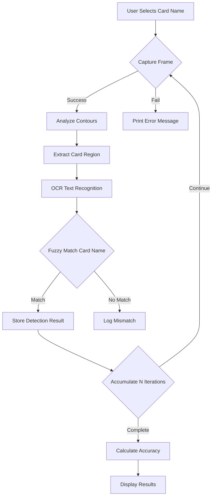

# MTG Card Scanner - Architecture Design Document

## 🏛️ High-Level Architecture

### Overview

The MTG Card Scanner follows a **modular component-based architecture** with clear separation of concerns:

```
┌─────────────────────────────────────────────────────┐
│                      User Interface                   │
│              (main.py - CLI Menu System)             │
└───────────────────┬──────────────────────────────────┘
                    │
┌───────────────────▼──────────────────────────────────┐
│                  VisionApp Class                      │
│          (State Management & Orchestration)           │
├──────────────────────────────────────────────────────┤
### Input → Processing → Output Pipeline

```
Camera Frame (RGB) 
    ↓
Preprocessing (Grayscale, Threshold)
    ↓
Contour Detection & Filtering
    ↓
Region of Interest Extraction
    ↓
OCR Text Recognition
    ↓
Card Name Fuzzy Matching
    ↓
Confidence Scoring & Validation
    ↓
Storage in DetectionResult object
```

---

## 🔄 State Management Strategy

### VisionApp Internal State

| State Variable | Purpose | Persistence |
|----------------|---------|-------------|
| `captured_images` | Stores frame captures per card | Volatile (reset per session) |
| `detection_results` | Latest detection for each card | Volatile |
| `settings` | Configuration values from JSON | Persistent between runs |
| `current_frame` | Most recent frame buffer | Transient |

### Event-Driven Design

The system uses **async/await** patterns for non-blocking operations:

```python
async def capture_and_detect_one_image(...):
    await camera_capture()  # Non-blocking I/O
    result = process_detection(frame)  # CPU-bound computation
    return result
```

---

## 🔌 Interface Contracts

### Camera Interface

```python
def capture_frame_from_camera() -> Tuple[bool, Optional[PILImage]]:
    """
    Contract: Capture single frame from camera source.
    
    Returns:
        (True, image) on success
        (True, None) if capture failed but returned gracefully
        (False, None) if device not found/hardware error
    """
```

### Detection Interface

```python
@dataclass
class DetectionResult:
    """
    Immutable container for detection output.
    
    Attributes must be set to valid values after detection completes.
    """
    name: str          # Card identifier (normalized lowercase)
    confidence: float  # Score in [0, 1]
    is_valid: bool     # Read-only property combining validation checks
```

### Scanner Interface

```python
class VisionApp:
    async def capture_and_detect_one_image(
        self, card_name: str
    ) -> Optional[DetectionResult]:
        """
        Single-shot detection attempt.
        
        Raises:
            None - Returns None on failure silently
        
        Returns:
            DetectionResult if card detected, else None
        """
    
    async def run_continuous_capture(
        self, card_names: List[str]
    ) -> Dict[str, Any]:
        """
        Multi-iteration batch processing for statistics.
        
        Returns dict with keys:
            - 'results': raw detections per iteration
            - 'best_results': aggregated best scores
            - 'final_accuracy': percentage metric
        """
```

---

## 🗂️ Module Dependencies

```
┌──────────────┐      ┌──────────────┐      ┌──────────────┐
│   camera.py  │───┬──►│ detection.py │───┬──►│ scanner.py  │
└──────────────┘   │   └──────────────┘   │   └──────────────┘
                    │          ▲           │   ┌──────┐       │
                    │          │           │   │      │       │
                    │    (Shared types)     │   └──────┘       │
                    │          │           │                  │
---

## 📁 File Organization Rationale

| File | Responsibility | Why Separate? |
|------|----------------|---------------|
| `camera.py` | Hardware abstraction | Easy to swap implementations (webcam vs. phone camera) |
| `detection.py` | CV algorithms | Independent of hardware, can use different models |
| `scanner.py` | Application logic | Orchestrates both layers, holds state |
| `main.py` | CLI glue code | Entry point that wireframes user interaction |

---

## 🚀 Extensibility Points

### Adding a New Detection Method

To add template matching instead of OCR:

```python
# In detection.py
def detect_by_template_matching(frame, templates) -> DetectionResult:
    cv2.matchTemplate(...)  # Implementation details
    return DetectionResult(...)
```

The `VisionApp` would need minimal changes to call the new method.

---

### Adding Database Storage

In `scanner.py`:

```python
async def save_result_to_db(self, result):
    await self.db_connection.execute(
        "INSERT INTO detections ...", result.to_dict()
    )
```

The detection pipeline remains unchanged; persistence is added at the boundary.

---

## 🔒 Security & Reliability Considerations

- Camera access handled via OS permissions (no code changes needed)
- All external image data validated for buffer size before processing
- Fuzzy matching prevents false positives via configurable threshold
- Graceful degradation: system continues if camera unavailable

---

*Architecture Version: 1.0 | Last Updated: October 9, 2026*
                    └──────────▼────────┬───┴──────────────────┘
                                       │
                               External Libraries
                               - PIL (image processing)
                               - numpy (numerical ops)
                               - opencv (CV algorithms)
```

│  ┌──────────────┐    ┌─────────────────────────────┐ │
│  │ Camera Layer │    │   Detection Pipeline        │ │
│  │  (camera.py) │◄──►│   (detection.py)            │ │
│  └──────────────┘    │   - Contour Analysis         │ │
│                      │   - OCR Integration          │ │
│                      │   - Card Matching            │ │
│                      └─────────────────────────────┘ │
│                              │                        │
│                      ┌───────▼────────┐              │
│                      │   Database     │              │
│                      │ (database.py)  │              │
│                      └────────────────┘              │
└──────────────────────────────────────────────────────┘
```

### Component Interaction Flow


